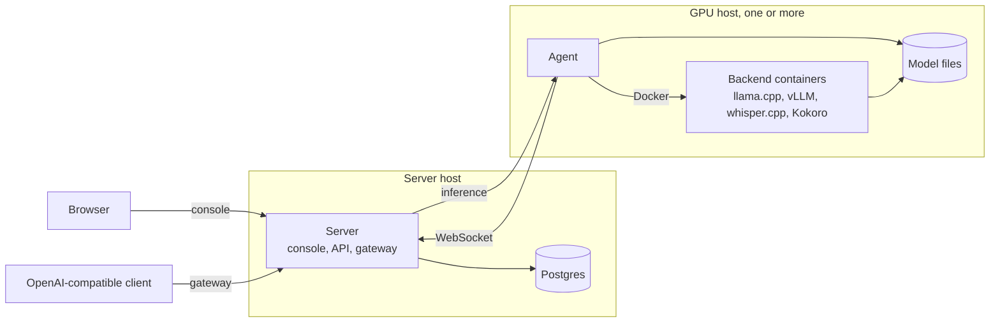
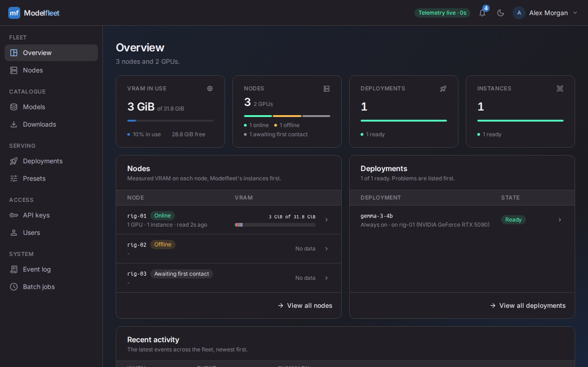
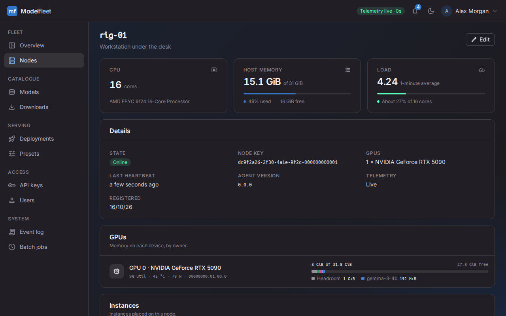
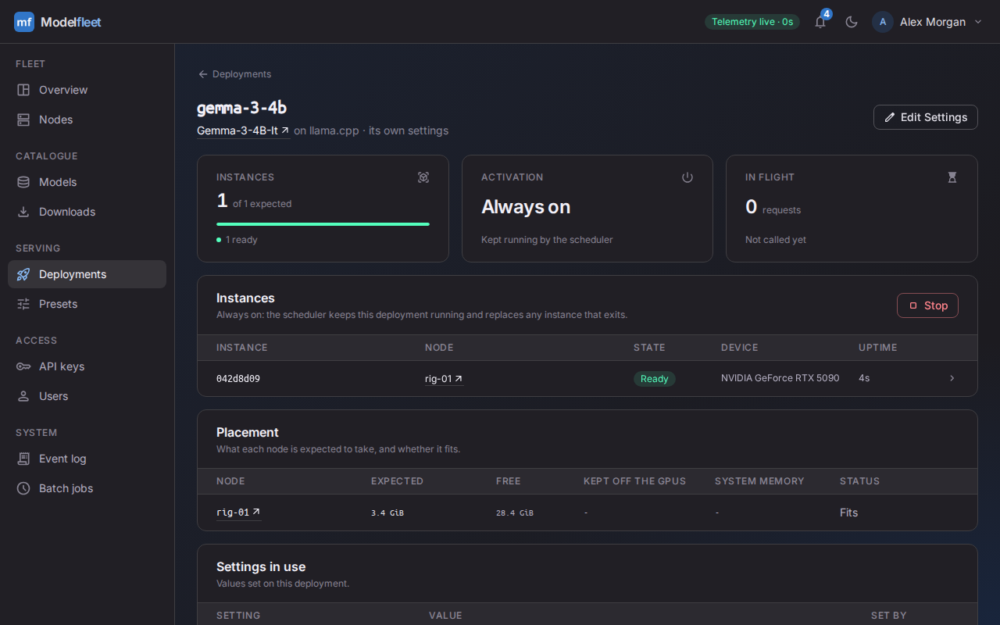
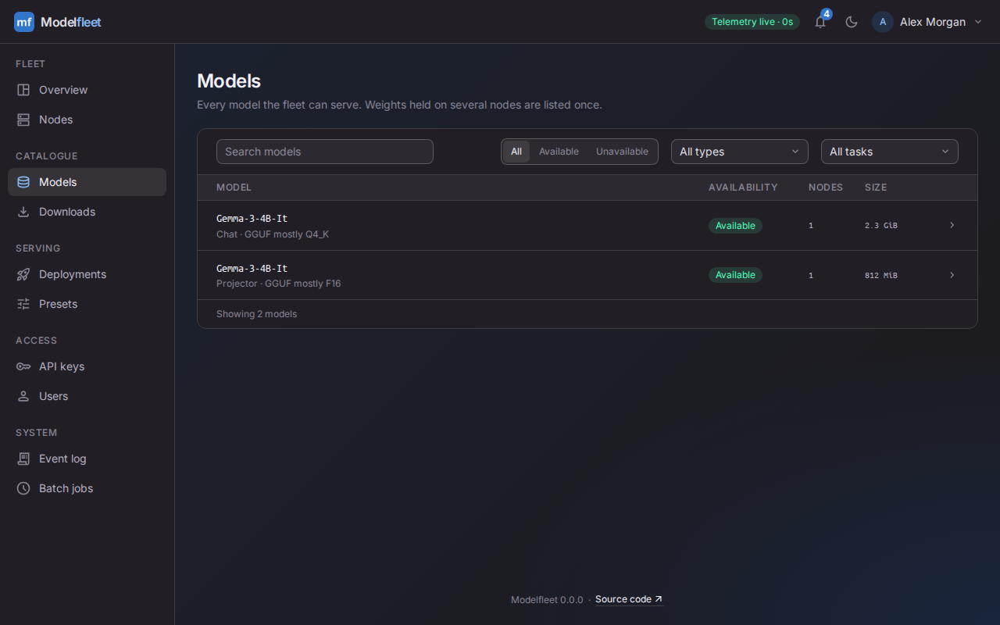

  <h1>Modelfleet</h1>
  <h3>Deploy, manage and hot-swap AI models on your own GPUs</h3>

Modelfleet is a web console for running AI models on your own machines. An agent on each GPU host runs llama.cpp,
vLLM, vLLM-Omni, whisper.cpp and Kokoro in Docker containers. A central server exposes them through one
OpenAI-compatible API.

I built Modelfleet to serve more models than my GPUs can hold at once, without managing every host by hand. It can load
a model when a request arrives, stop it after it becomes idle and check available memory before each start.

> **Note:** Modelfleet is a young project without wide testing, and its documentation is still a work in progress.
> Keep backups and use it at your own risk.

## Features

- Runs llama.cpp, vLLM, vLLM-Omni, whisper.cpp and Kokoro on NVIDIA GPUs, configured through forms or YAML.
- Catalogues and fingerprints model files across nodes, so a deployment can use the same weights on different machines.
- Places deployments on selected nodes and GPUs, either always on or loaded on demand and stopped when idle.
- Checks available GPU memory before starting a deployment.
- Exposes an OpenAI-compatible gateway on its own port, with API keys issued from the console.
- Downloads public, private and gated Hugging Face models directly to a node.
- Shows live GPU telemetry, with memory matched to the container holding it.
- Provides user and system administration, a fleet event log and scheduled jobs.

## Architecture

The agent connects out to the server, which never needs to reach a GPU host to manage it. The server reaches the
agent's inference relay to serve gateway requests. The agent starts and stops backend containers through the host's
Docker socket, and shares its model files with them.

## Screenshots

 
 

## Limitations

Modelfleet does not yet support:

- GPUs other than NVIDIA, or hosts other than Linux on x86-64.
- Stopping one model to make room for another. A request for an on-demand model that doesn't fit in free GPU memory
  is refused.
- Automatic node selection. Each deployment runs only on the nodes and GPUs you select for it.
- Limiting what an API key can reach. Every key can call every deployment, and only system admins can create keys.
- Gateway endpoints beyond chat completions, embeddings, audio and the model list. The legacy completions, Responses
  and image APIs are not available.

## Install

Modelfleet runs from one compose file on a machine with Docker and the NVIDIA Container Toolkit, behind a reverse proxy
that handles HTTPS. Follow the [deployment guide](DEPLOYMENT.md) to install it, add GPU machines and upgrade.

## Connecting clients

As a system admin, create a key from **API keys** in the user menu. Point any OpenAI-compatible client at the gateway's
`/v1` URL, for example `https://inference.example.com/v1`, with that key. The model name is the deployment's name.

## AI use

Modelfleet is developed with the help of AI. As an experienced developer, I oversee every change and review the code
it produces.

## Contributing

See [CONTRIBUTING.md](CONTRIBUTING.md). Please report security issues privately, as described in
[SECURITY.md](SECURITY.md).

## Licence

Copyright (C) 2026 Louis Collins

Modelfleet is licensed under the [GNU Affero General Public License v3.0 only](LICENSE) (`AGPL-3.0-only`).
